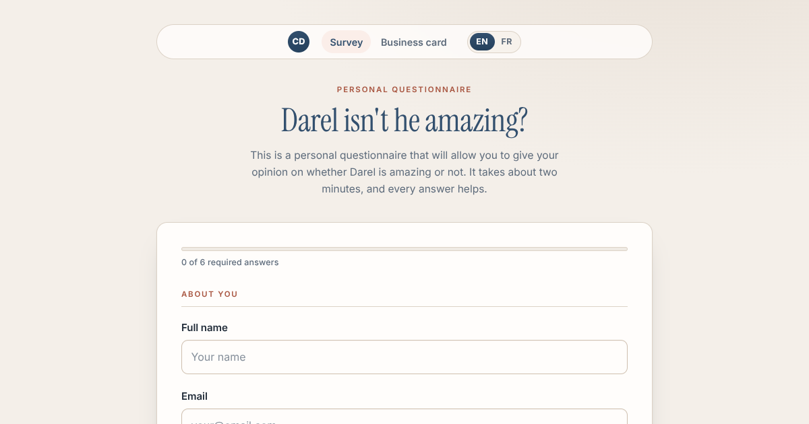
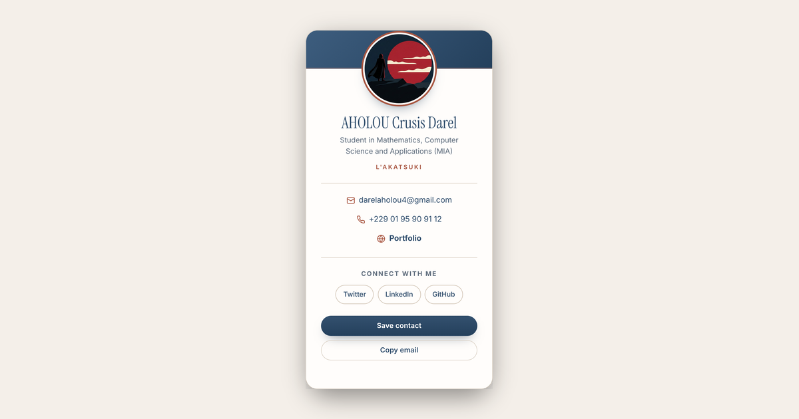

# Darel-survey

Site personnel de **Crusis Darel Aholou** : un questionnaire, une carte de visite
numérique et une page de remerciement. HTML, CSS et JavaScript natifs — aucune
dépendance, aucun build, aucun tracker.




## Les pages

| Page | Fichiers | Rôle |
| --- | --- | --- |
| Sondage | `index.html` · `survey.css` · `survey.js` | Questionnaire personnel envoyé via Formspree, avec barre de progression et brouillon automatique. |
| Carte de visite | `business-card.html` · `business-card.css` · `business-card.js` | Coordonnées, portfolio, réseaux sociaux, fichier de contact `.vcf`, copie de l'e-mail. |
| Remerciement | `thanks.html` · `thanks.css` | Page affichée après l'envoi (`_next` de Formspree). |
| Styles partagés | `base.css` | Jetons de design, barre de navigation, boutons, pied de page, thème sombre. |
| Traductions | `i18n.js` | Bascule anglais / français sans dépendance. |

## Démarrage

```bash
# serviteur local (recommandé)
npm start            # ou : python3 -m http.server 8000
# puis http://localhost:8000/

# vérifications
npm test             # structure, traductions, liens, syntaxe JS
```

## Ce que fait le site

**Langue** — bascule EN/FR dans la barre supérieure, mémorisée dans
`localStorage`, détection de la langue du navigateur au premier passage,
`<html lang>` mis à jour et contenus traduits (libellés, aides, messages).

**Sondage**
- barre de progression « *x* / 6 réponses obligatoires » ;
- brouillon enregistré localement pendant la saisie, restauré au rechargement,
  effaçable d'un clic (« Recommencer ») ;
- validation native (e-mail, âge 1–120, champs requis) avec messages d'aide
  uniquement après interaction ;
- compteur de caractères sur le champ libre (600 max) ;
- anti double-envoi et état « Envoi en cours… » ;
- envoi classique vers Formspree : tout fonctionne même sans JavaScript.

**Carte de visite**
- bouton « Ajouter au téléphone » (fichier `assets/crusis-darel-aholou.vcf`) ;
- copie de l'e-mail avec retour visuel, partage natif quand l'appareil le permet ;
- monogramme de secours si l'image distante ne charge pas (hotlink bloqué,
  hors ligne) ;
- liens `mailto:` / `tel:` / portfolio / réseaux avec icônes SVG intégrées.

**Design et accessibilité**
- typographie **auto-hébergée** : Inter (variable) pour le texte, Instrument Serif
  pour les titres — deux fichiers `woff2` locaux, préchargés, licences OFL 1.1
  dans `assets/fonts/LICENCES.txt` ;
- jetons CSS (couleurs, rayons, ombres) et thème sombre automatique ;
- mise en page fluide de 320 px à grand écran, cibles tactiles confortables ;
- focus visible, lien d'évitement au clavier, contrastes AA vérifiés,
  `aria-live` sur les messages, libellés associés à chaque champ ;
- animations coupées si `prefers-reduced-motion`, styles d'impression pour la
  carte ;
- 0 violation axe-core (WCAG 2.1 A + AA) sur les trois pages, en clair et en
  sombre.

**Performance et partage**
- aucune police, image ou script externe : tout est servi depuis le dépôt
  (`base.css` + 2 polices ≈ 70 Ko au total) ;
- illustration d'en-tête originale et locale (`assets/profil.jpg`) — remplaçable par
  n'importe quelle photo du même nom ;
- favicon SVG, manifeste, `theme-color`, `robots.txt`, `sitemap.xml`,
  `.nojekyll` ;
- balises Open Graph / Twitter avec images d'aperçu dans `assets/`.

## Structure

```
.
├── index.html            # sondage
├── business-card.html    # carte de visite
├── thanks.html           # confirmation d'envoi
├── base.css              # socle commun (thèmes, nav, boutons)
├── survey.css
├── business-card.css
├── thanks.css
├── i18n.js               # dictionnaires EN/FR + bascule
├── survey.js             # progression, brouillon, validation
├── business-card.js      # copie, partage, image de secours
├── icon.svg              # favicon / icône PWA
├── site.webmanifest
├── assets/
│   ├── profil.jpg        # illustration de la carte (remplaçable)
│   ├── crusis-darel-aholou.vcf
│   ├── fonts/            # Inter + Instrument Serif (woff2, OFL 1.1)
│   └── preview-*.png     # aperçus (README + Open Graph)
├── tools/check.mjs       # vérifications statiques (npm test)
└── .github/workflows/checks.yml
```

## Notes

- L'endpoint Formspree est `https://formspree.io/f/xojnnrro`. En cas de
  changement de compte, il suffit de modifier l'attribut `action` du formulaire
  et la valeur `_next`.
- Les identifiants attendus par les projets freeCodeCamp (`#title`,
  `#survey-form`, `#name`, `#email`, `#number`, `#dropdown`, `#submit`,
  `.business-card`, `.profile-image`, `.full-name`, `.social-media`, etc.) sont
  conservés.
- Le brouillon du formulaire reste **dans le navigateur du visiteur**
  (`localStorage`) et est supprimé après envoi.
- Site publié : <https://darelaholou4-ux.github.io/Darel-survey/>
